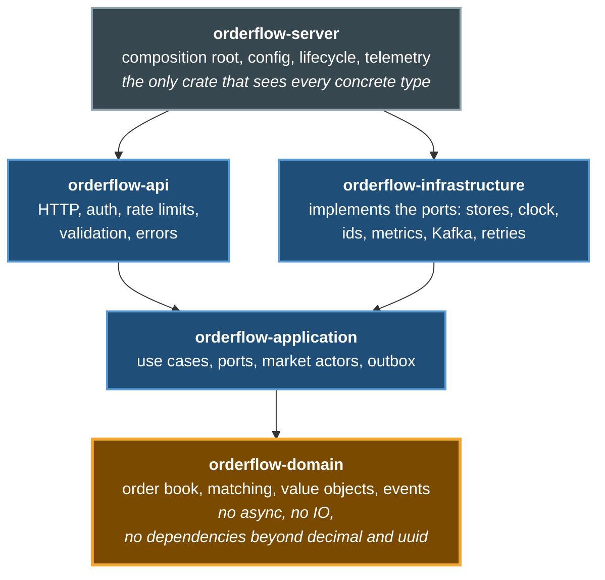
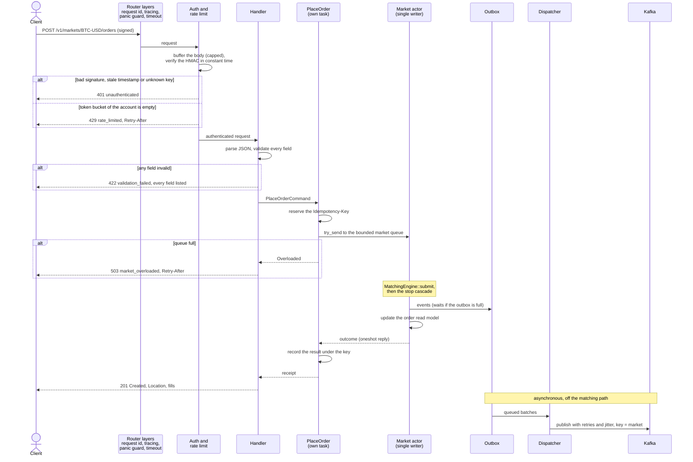
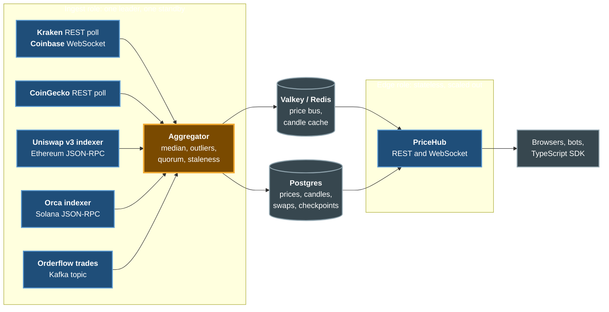
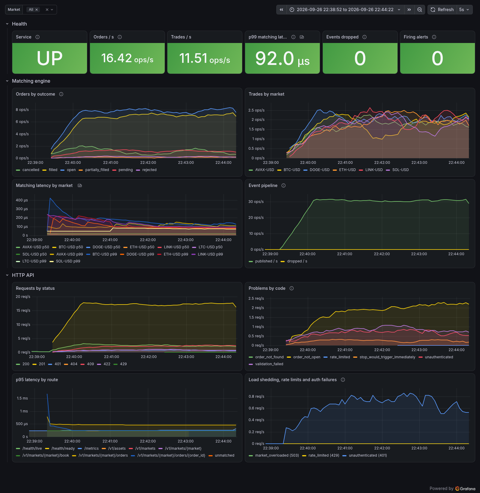
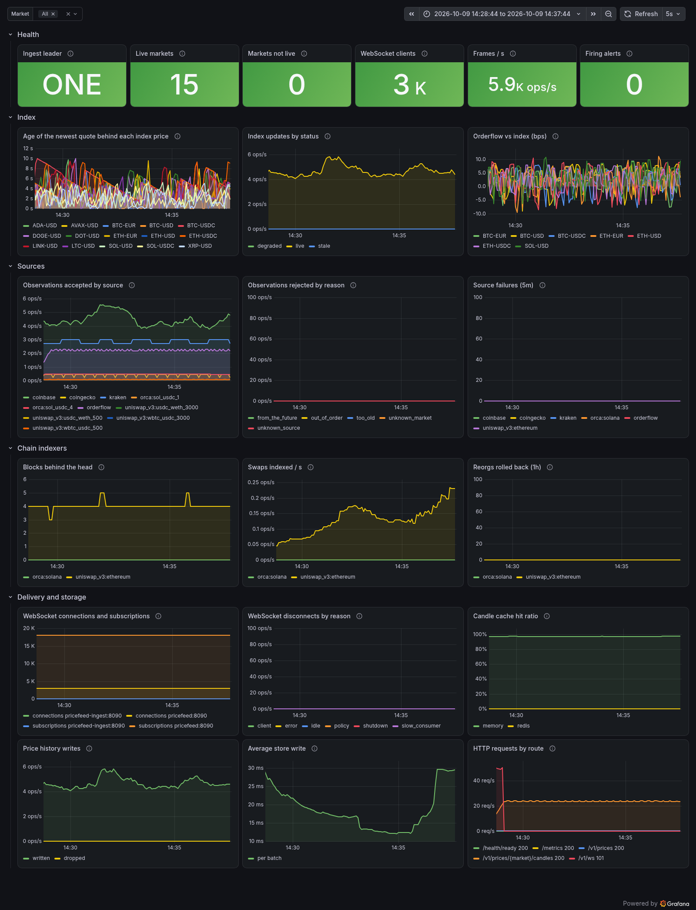

# Orderflow

[](https://github.com/davidmm07/orderflow/actions/workflows/ci.yml)

Orderflow is a price-time priority matching engine with a trading API,
written in Rust. It is a reference for the kind of service that sits at the
core of an exchange, where correctness, security and operability matter
more than feature count.

Next to the exchange runs a market data service, the price feed: one index
price per market, aggregated from exchange APIs, CoinGecko and in-house
Ethereum and Solana indexers, streamed to clients over WebSocket and
backed by Postgres with cache tiers for traffic spikes. See
[Market data: the price feed](#market-data-the-price-feed).

If you are new to the codebase, follow [KT_README.MD](KT_README.MD) first.

## Features

Matching
- Limit, market, stop-limit and stop-market orders, with `gtc`, `ioc` and
  `fok` time in force.
- Stop orders wait outside the book and fire when the last trade price
  reaches them. A fired stop can move the price and fire further stops;
  the whole cascade settles within the request that caused it.
- Post-only orders and self-trade prevention (`cancel_newest`,
  `cancel_oldest`).
- Exact decimal arithmetic. The domain crate denies float arithmetic.

Instruments
- 16 markets over 14 assets out of the box: USD, EUR and stablecoin
  quotes plus an ETH-BTC cross.
- Listing another instrument is an edit to `config/instruments.json`. The
  catalog is validated as a whole at startup.
- Clients discover what is listed through `/v1/assets` and
  `/v1/markets?base=&quote=`.

API
- Versioned REST under `/v1` with HMAC-SHA256 signed requests.
- Per-account rate limiting and `Idempotency-Key` support.
- Strict validation that reports every invalid field in one response.
- RFC 9457 problem documents for every failure.

Events
- Every state change becomes a domain event with a gap-free sequence
  number per market.
- Events go to Kafka under a versioned JSON schema, keyed by market so
  each market keeps its order.

Market data (price feed)
- One index price per market from CoinGecko, Kraken, Coinbase (WebSocket),
  Uniswap v3 swaps indexed from Ethereum and Orca pools read from Solana:
  the median of fresh quotes, outliers removed, quorum and staleness
  tracked, every value explainable by its per-source breakdown.
- In-house chain indexers with reorg rollback (EVM) and slot-consistent
  reads (Solana), tested offline against recorded mainnet responses.
- WebSocket fanout with conflation: 20,000 clients on one node in a local
  load test, at about 12 KiB of memory each.
- Postgres history behind in-process, Redis and CDN cache tiers. One
  ingest leader elected through Postgres; stateless edge nodes fed by
  Redis scale out.
- A TypeScript client SDK and CLI, and AWS Terraform (RDS, ElastiCache,
  ECS Fargate, ALB, CloudFront) that CI validates and nobody applies.

Operations
- Prometheus metrics from every service, alert rules with unit tests, and
  provisioned Grafana dashboards in the compose stack.
- Liveness and readiness probes, JSON logs with request ids.
- Load shedding, backpressure, retries with jittered backoff.
- Graceful shutdown that drains every queued order before exit.

## Quick start

You need `rustup`, `openssl` and `curl`. The toolchain pinned in
`rust-toolchain.toml` installs itself on the first `cargo` call.

```bash
make env
```

```bash
make run
```

`make env` creates two traders, A and B, because an account never trades
with itself. In a second terminal:

```bash
scripts/signed-request.sh POST /v1/markets/BTC-USD/orders '{"side":"sell","type":"limit","price":"64000.50","quantity":"0.5"}'
```

```bash
ORDERFLOW_CREDENTIAL=2 scripts/signed-request.sh POST /v1/markets/BTC-USD/orders '{"side":"buy","type":"market","quantity":"0.2"}'
```

```bash
curl -s localhost:8080/v1/markets/BTC-USD/book
```

The price feed needs no setup: it reads public exchange APIs and public
Ethereum and Solana RPC nodes, and keeps history in memory when no
database is configured. Its index prices fill within a few seconds:

```bash
make run-pricefeed
```

```bash
curl -s localhost:8090/v1/prices/ETH-USDC
```

With Node.js 20 or later, the TypeScript CLI streams them live:

```bash
make prices MARKETS="BTC-USD ETH-USDC SOL-USDC"
```

To run every scenario flow against the running server (see
[Scenario flows](#scenario-flows-postman)):

```bash
make postman-env
```

```bash
make flows
```

To run everything in containers: the exchange on Kafka (Redpanda), the
price feed as an ingest node and an edge node on Postgres and Valkey, and
Prometheus and Grafana
([Observability and monitoring](#observability-and-monitoring)). An `.env`
created before the price feed existed needs its database password first:

```bash
make pricefeed-env
```

```bash
make up
```

```bash
make consume
```

`make help` lists every target.

## Architecture

### Clean architecture over a layered one

The full reasoning is in
[ADR 0001](docs/adr/0001-clean-architecture-over-layered.md).

A layered architecture points dependencies down towards persistence:
presentation calls business logic, which calls data access. Applied here,
the matching engine would depend on how orders are stored and how events
are published. In an exchange the matching rules are the part that has to
last, while transports and brokers get replaced, so that direction is
wrong for this system.

Clean architecture points every dependency inwards, towards the domain.
The reasons it was chosen:

1. The rules outlive the plumbing. The API could move from REST to gRPC or
   FIX, and events could move off Kafka, without touching the domain crate.
2. Correctness is cheap to test. The engine is plain Rust with no IO, so
   property tests run thousands of random order flows against it in
   milliseconds, without containers or mocks.
3. Replay is possible. The engine receives time and ids as inputs and never
   reads them itself, so replaying the same command journal always rebuilds
   the same book.
4. The compiler enforces the boundaries. Each ring is its own crate, and
   `orderflow-domain` does not list tokio, axum or rdkafka as dependencies,
   so using them there fails the build.
5. A port can have several adapters. Events can go to the log, to Kafka or
   to both, and storage is in memory today with room for a database.

The cost is more types and explicit mapping at each boundary. A CRUD
service would not need that. The core of an exchange does.

### Dependency rule

Arrows point from a crate to the crates it depends on.



### Life of an order

Dashed arrows are responses. The `alt` boxes are the ways a request is
turned away before it reaches the matching engine.



### Crates

| Crate | Ring | Responsibility |
|---|---|---|
| [`orderflow-domain`](crates/domain) | Entities | Value objects, order book, matching engine, domain events and errors |
| [`orderflow-application`](crates/application) | Use cases | `PlaceOrder`, `CancelOrder`, `OrderQueries`, ports, market actors, outbox |
| [`orderflow-infrastructure`](crates/infrastructure) | Adapters | In-memory stores, monotonic clock, UUIDv7 ids, Prometheus metrics, event sinks, Kafka |
| [`orderflow-api`](crates/api) | Delivery | Routes, DTOs, validation, HMAC auth, rate limiting, problem responses |
| [`orderflow-server`](crates/server) | Composition root | Env config, wiring, telemetry, graceful shutdown |

The price feed is a second bounded context built the same way. It shares
only `MarketId`, `Timestamp` and the `Clock` port with the exchange.

| Crate | Ring | Responsibility |
|---|---|---|
| [`orderflow-marketdata`](crates/marketdata) | Entities and use cases | Sources, observations, the index rule, candles, the aggregator actor, ports and sinks. No I/O, no floats |
| [`orderflow-ingest`](crates/ingest) | Adapters (inbound) | CoinGecko, Kraken and Coinbase connectors, the Uniswap v3 and Orca indexers, Orderflow's trades, the source supervisor |
| [`orderflow-storage`](crates/storage) | Adapters (outbound) | Postgres store and leader lease, Redis bus, memory and Redis candle caches, in-memory store |
| [`orderflow-pricefeed`](crates/pricefeed) | Delivery and composition root | REST, WebSocket hub and sessions, metrics, config, the `pricefeed` binary and its roles |

## SOLID in practice

The `lib.rs` of each crate lists the principles that crate applies, and the
doc comment of each type says which one it follows.

| Principle | Where | How |
|---|---|---|
| Single responsibility | `OrderBook`, `MatchingEngine`, `MarketSpec` | Resting liquidity, matching rules and trading parameters live in three types, each with one reason to change |
| Open/closed | `RetryingPublisher`, `FanoutPublisher`, tower layers | New behavior wraps existing code through decorators and layers |
| Liskov substitution | Every port | The in-memory repository, the test fakes and a future database adapter all follow the same documented contract |
| Interface segregation | `ports.rs` | `Clock`, `OrderIdGenerator`, `OrderRepository`, `EventPublisher`, `IdempotencyStore` and `Metrics` are separate, small traits |
| Dependency inversion | Application and server crates | Use cases depend on traits they own; only the composition root knows concrete types |

## Design patterns

| Pattern | Where | Why here |
|---|---|---|
| Ports and Adapters (Hexagonal) | [`ports.rs`](crates/application/src/ports.rs), infrastructure crate | Keeps technology choices out of the core |
| Actor / single writer | [`market.rs`](crates/application/src/market.rs) | One task owns each book, so there are no locks and every market has a total order |
| Command | [`commands.rs`](crates/application/src/commands.rs), actor `Request` | Requests are values that can be compared for idempotency, queued and replayed |
| Outbox | [`outbox.rs`](crates/application/src/outbox.rs) | Keeps broker latency off the matching path; bounded for backpressure |
| Repository | [`OrderRepository`](crates/application/src/ports.rs), [`orders.rs`](crates/infrastructure/src/memory/orders.rs) | Read model behind a collection-like interface |
| Decorator | [`retry.rs`](crates/infrastructure/src/events/retry.rs) | Adds retries with backoff and jitter to any publisher |
| Composite | [`fanout.rs`](crates/infrastructure/src/events/fanout.rs) | Several sinks behave as one |
| Observer (pub/sub) | [`broadcast.rs`](crates/infrastructure/src/events/broadcast.rs) | In-process subscribers to the event stream |
| Strategy | [`SelfTradePrevention`](crates/domain/src/order.rs) | Self-trade policy chosen per order and applied at one point |
| Builder | [`MarketSpecBuilder`](crates/domain/src/market.rs) | Validates a whole market configuration at once |
| Value Object / Newtype | [`numeric.rs`](crates/domain/src/numeric.rs), [`ids.rs`](crates/domain/src/ids.rs) | Invalid prices and ids cannot be represented |
| Null Object | [`NoopMetrics`](crates/application/src/ports.rs) | Removes `Option<Metrics>` checks from the runtime |
| Registry | [`registry.rs`](crates/application/src/registry.rs), [`catalog.rs`](crates/domain/src/catalog.rs) | Read-only map from market to its actor; validated list of instruments |
| Adapter | [`extract.rs`](crates/api/src/extract.rs) | Axum extractors that reject with problem documents |
| Chain of Responsibility | [`router.rs`](crates/api/src/router.rs) | Middleware stack with one concern per layer |
| Data Transfer Object | [`dto.rs`](crates/api/src/dto.rs), [`wire.rs`](crates/infrastructure/src/events/wire.rs) | Public contracts kept separate from the domain model |
| Composition Root / Factory | [`app.rs`](crates/server/src/app.rs) | The single place where dependencies are injected |
| Strategy + Supervisor | [`runtime.rs`](crates/ingest/src/runtime.rs) | Every exchange and chain is a `Source`; one supervisor restarts any of them with backoff, honoring `Retry-After` |
| Actor / single writer | [`pipeline.rs`](crates/marketdata/src/pipeline.rs) | One task owns the price index and publishes on a fixed cadence |
| Queue-based load leveling | [`StoreWriter`](crates/marketdata/src/sinks.rs) | Database latency and outages stay off the price path |
| Conflation | [`ConflatingPublisher`](crates/marketdata/src/sinks.rs), [`hub.rs`](crates/pricefeed/src/hub.rs) | Only the newest price per market is kept, so slow consumers cost no memory |
| Observer | [`PriceHub`](crates/pricefeed/src/hub.rs) | One `watch` channel per market fans out to every WebSocket session |
| Decorator + Single Flight | [`cache.rs`](crates/storage/src/cache.rs), [`redis.rs`](crates/storage/src/redis.rs) | Cache tiers wrap the store; concurrent identical reads share one load |
| Leader election (lease) | [`LeaderLease`](crates/storage/src/postgres.rs) | Exactly one ingest node computes prices; a standby takes over |
| Tolerant Reader | [`venue.rs`](crates/ingest/src/venue.rs) | The Kafka consumer reads only the event fields it needs |

## API

| Method | Path | Auth | Purpose |
|---|---|---|---|
| GET | `/v1/assets` | public | Listed assets with their precision |
| GET | `/v1/markets?base=&quote=` | public | Markets with their tick, lot and size limits, optionally filtered by asset |
| GET | `/v1/markets/{market}` | public | One market |
| GET | `/v1/markets/{market}/book?depth=N` | public | Aggregated book, best price first, with its sequence number and last trade price |
| POST | `/v1/markets/{market}/orders` | signed | Place an order; supports `Idempotency-Key` |
| GET | `/v1/markets/{market}/orders/{id}` | signed | Read one of your orders |
| DELETE | `/v1/markets/{market}/orders/{id}` | signed | Cancel one of your resting or pending orders |
| GET | `/health/live`, `/health/ready` | public | Probes |
| GET | `/metrics` | public | Prometheus text format |

The full contract is in [docs/openapi.yaml](docs/openapi.yaml) and the
error codes are in [docs/errors.md](docs/errors.md).

### Order types

| `type` | Required fields | Behavior |
|---|---|---|
| `limit` | `price` | Matches up to `price`; the rest follows `time_in_force` (`gtc` rests, `ioc` and `fok` never do) |
| `market` | none beyond `side` and `quantity` | Matches at the best prices; any rest is cancelled |
| `stop_limit` | `stop_price`, `price` | Waits as `pending` until a trade reaches `stop_price`, then acts as a limit order |
| `stop_market` | `stop_price` | Waits as `pending` until a trade reaches `stop_price`, then acts as a market order |

A buy stop fires when a trade prints at or above its stop price, and a sell
stop at or below. A stop the market has already reached is rejected with
`409 stop_would_trigger_immediately`. Pending stops can be cancelled and
never show in the public book. Fills in a placement response carry
`liquidity`: `taker` for matches on arrival, `maker` when a stop fired by
the same request traded against the order.

### Instruments

The catalog in [`config/instruments.json`](config/instruments.json) has two
lists: assets (code, name, decimals) and markets (base, quote, tick size,
lot size, quantity limits). To list a new instrument:

1. Add the asset to `assets` if it is not there yet.
2. Add the market to `markets`, referencing the base and quote codes.
3. Run `cargo test -p orderflow-server`; `bundled_catalog_is_valid` loads
   the file with the same rules as the server.
4. Deploy. The server starts one engine per market.

The loader rejects unknown assets, duplicates, a market whose base and
quote are the same, and lot sizes with more decimals than the base asset
supports, and it lists every problem in one message.
[ADR 0004](docs/adr/0004-instrument-catalog-as-data.md) covers how the
design scales further: listing without a restart and sharding markets
across nodes.

Some API design choices:

- Order resources nest under their market. The market is the shard key,
  so the path tells the server which actor owns the order.
- Decimals are strings on the wire. Most client languages read JSON
  numbers as binary floats, which cannot hold `0.1` exactly.
- Placement returns `201` with a `Location` header and the immediate fills
  in the body, so a client learns its execution in one round trip.
- Orders that belong to another account return `404`. A `403` would
  confirm that the id exists.

### Request signing

```
signature = hex(HMAC_SHA256(secret, timestamp + METHOD + path_and_query + body))
headers:    x-orderflow-key, x-orderflow-timestamp (unix seconds), x-orderflow-signature
```

The body is part of the signed string, so an intermediary cannot change an
order, and the timestamp window (30 seconds by default) limits replays.
`sign_request` in [`auth.rs`](crates/api/src/auth.rs) is the reference
implementation, and both [`examples/sign.rs`](crates/api/examples/sign.rs)
and [`scripts/signed-request.sh`](scripts/signed-request.sh) call it.

## Data validation

Validation happens in four layers:

1. Serde runs with `deny_unknown_fields` on every request type, so a typo
   such as `"prise"` is rejected instead of ignored.
2. The request validator in [`validation.rs`](crates/api/src/validation.rs)
   parses each field into domain types and collects every problem, so one
   response lists all of them. Decimals must be plain (`"101.25"`; `"1e2"`,
   `"-1"` and `" 1"` are rejected) and at most 40 characters long.
3. Value objects such as `Price`, `Quantity`, `MarketId` and `AccountId`
   can only be built through constructors that enforce their invariants.
4. `MatchingEngine::submit` checks tick size, lot size and limits again,
   because the domain does not rely on its callers having done it.

## Error handling

- Each ring has its own error type: `DomainError`, `ApplicationError` and
  `ApiError`. Each one wraps the inner one, and every variant has a stable
  `code()` used in logs, metrics and responses.
- The HTTP mapping is a `match` with no catch-all arm, so a new error
  variant fails to compile until someone assigns it a status.
- 5xx responses carry a generic `detail`. The real cause goes to the log
  together with the request id.
- Workspace lints deny `unwrap`, `expect`, `panic!`, `todo!` and
  `unimplemented!` outside tests. `CatchPanicLayer` still turns an
  unexpected panic into a 500 problem instead of a dropped connection.
- Placement runs on its own task and stores its result under the
  idempotency key, so a client can retry after a timeout, a 503 or a
  disconnect without creating a second order.

## Security

- Requests are signed with HMAC and verified in constant time, inside a
  replay window. Unknown keys go through the same HMAC work against a decoy
  secret, so response timing does not reveal which key ids exist.
- Secrets must be at least 32 bytes. Their `Debug` output is redacted, and
  helper tools read them from the environment instead of the command line.
- `.env` files are git-ignored. The repository only tracks
  [`.env.example`](.env.example), whose secret values are empty, and
  `make env` generates a local secret.
- Body size, decimal length, id length, the idempotency store and every
  queue have limits. Rate limit buckets are only created for authenticated
  accounts, so anonymous traffic cannot grow them.
- Identifiers are restricted to an allow list of characters and are safe
  to log or use as Kafka keys without escaping.
- `unsafe` code is forbidden in every crate. CI runs `cargo deny` for
  advisories, licenses and sources ([deny.toml](deny.toml)).
- The server binds to `127.0.0.1` unless configured otherwise. The
  container is distroless, runs as non-root and has a read-only filesystem.

## Reliability and performance

- Each market has a single writer
  ([ADR 0002](docs/adr/0002-single-writer-market-actors.md)), so the
  matching path takes no locks.
- A full engine queue answers `503 market_overloaded` right away instead
  of queueing work that would finish too late.
- The outbox is bounded. A slow broker slows the engine down instead of
  filling memory.
- Events are delivered at least once, with ids for de-duplication and
  per-market ordering
  ([ADR 0003](docs/adr/0003-event-delivery-and-durability.md)).
- On SIGTERM the server stops accepting requests, each engine drains its
  queue, the outbox closes and the dispatcher flushes the remaining events
  before the process exits.

Matching benchmark (`make bench`, Criterion, release build, AMD Ryzen 7
5700U under WSL2; results vary by machine):

| Scenario | Median |
|---|---|
| Rest a non-crossing limit order on a 200 order book | about 1.2 us |
| Sweep 10 price levels (40 fills) with one order | about 19 us |

## Event streaming: Kafka, with Redpanda locally

The matching engine only matches. Everything that happens after a trade,
such as moving balances, publishing prices or checking risk, is done by
other services that read the event stream at their own pace. The engine
never waits for them, and adding a new one needs no change here.

Every state change in a market becomes one event on the topic
`orderflow.events.v1`:

| Event type | When |
|---|---|
| `order_accepted` | An order passed validation (stop orders arrive as `pending`) |
| `trade_executed` | Two orders matched |
| `order_cancelled` | An order was cancelled, by its owner or by a rule (IOC, FOK, self-trade prevention, no liquidity) |
| `stop_triggered` | A stop order reached its stop price and is about to be matched |

Who reads the stream in a real exchange, each as its own consumer group:

| Consumer | Uses the events to |
|---|---|
| Ledger and settlement | Move funds between buyer and seller on every `trade_executed` |
| Market data | Publish the trade tape, candles and live feeds to clients |
| Risk and surveillance | Track exposure per account and detect wash trading or spoofing |
| Notifications | Tell each account about its fills and cancels |
| Audit and analytics | Keep the full ordered history of every market; report volumes and fees |

A slow or crashed consumer does not slow matching: it resumes from its
last committed offset. Records are keyed by market, so every market stays
ordered on one partition; delivery is at least once, and `event_id`
(`{market}:{epoch}:{sequence}`) lets consumers drop duplicates and spot
gaps. `epoch` is the start time of the service run: sequences count from 1
again after a restart, and the epoch keeps those events from being
mistaken for duplicates
([ADR 0003](docs/adr/0003-event-delivery-and-durability.md)).

A record as it appears on the topic (`data` fields shortened):

```json
{"schema_version": 2, "event_id": "BTC-USD:1790463231117:5", "market": "BTC-USD",
 "epoch": 1790463231117, "sequence": 5, "occurred_at_ns": 1790463252161804702,
 "event_type": "trade_executed",
 "data": {"trade_id": 1, "price": "64000.25", "quantity": "0.002", "taker_side": "sell", "...": "..."}}
```

### What Redpanda is doing here

Redpanda is a streaming platform that speaks the Kafka protocol. In the
compose stack it stands in for a Kafka cluster: one container, no JVM and
no separate controllers, ready in seconds. The service uses the standard
Kafka client and contains no Redpanda-specific code, so in production
`ORDERFLOW_KAFKA_BROKERS` points at whatever Kafka-compatible cluster is
run there (Apache Kafka, Confluent, Amazon MSK or Redpanda). The reasoning
is in [ADR 0005](docs/adr/0005-redpanda-as-local-kafka.md).

`make run` does not need a broker: it uses the log sink and prints events
to the log. Kafka is used by the container image (built with
`--features kafka`) that `make up` starts:

```bash
make up
```

```bash
make consume
```

```bash
make topics
```

`make consume` prints each record as it arrives, and `make topics` shows
the six partitions with the number of records in each. From the host,
Kafka clients connect to `127.0.0.1:19092`; inside the compose network the
address is `redpanda:9092`.

## Market data: the price feed

The price feed is one reliable backend for market data. It ingests prices
from third-party APIs and from the chains themselves, turns them into one
index price per market, stores the history, and serves it to many clients
at once. Its code is the four `orderflow-marketdata`, `-ingest`,
`-storage` and `-pricefeed` crates, its configuration is
[`config/marketdata.json`](config/marketdata.json), and the decisions
behind it are ADRs [0006](docs/adr/0006-one-index-price-from-many-sources.md),
[0007](docs/adr/0007-in-house-chain-indexers.md) and
[0008](docs/adr/0008-price-fanout-and-caching.md).



The same binary runs as `PRICEFEED_ROLE=all` on a laptop (no database or
Redis needed), or as one `ingest` node plus any number of `edge` nodes in
production. `make up` runs the split version.

### Sources

| Source | Kind | Transport | Markets | Fresh for |
|---|---|---|---|---|
| CoinGecko | aggregator | REST poll every 30 s, exact decimals from the raw JSON | 12 USD and EUR markets | 5 min |
| Kraken | CEX | REST poll every 5 s, all pairs in one call | all 15 markets | 60 s |
| Coinbase Exchange | CEX | WebSocket ticker and heartbeat, sampled once a second | 12 USD and EUR markets | 60 s |
| Uniswap v3, 4 pools | DEX | Swap logs from Ethereum, 3 confirmations, reorg rollback | ETH-USDC, BTC-USDC | 3 min |
| Orca Whirlpools, 2 pools | DEX | Pool accounts from Solana at `confirmed`, `minContextSlot` | SOL-USDC | 30 s |
| Orderflow | venue, monitor only | The exchange's Kafka event topic | 7 markets | 5 min |

Every source implements one `Source` trait, and a supervisor restarts a
failing one with jittered backoff, honoring `Retry-After`, without
affecting the others. RPC URLs, which usually carry provider keys, come
from `.env` (`PRICEFEED_EVM_RPC_URL`, `PRICEFEED_SOLANA_RPC_URL`) and
default to public endpoints. Adding a market, a pair or a pool is an edit
to `config/marketdata.json`, validated as a whole at startup.

### The index price

For each market the aggregator takes the fresh quotes of its index
sources, computes their median, drops quotes further than
`max_deviation_bps` from it, and publishes the median of the rest. The
result says how far to trust it: `live` when at least `quorum` sources
agree, `degraded` when fewer back it or they disagree, `stale` when no
fresh source is left. Orderflow's own trades are a `monitor` source:
compared with the index and alerted on, never part of it. Every price
carries its breakdown:

```json
{
  "market": "ETH-USDC",
  "price": "2473.314464392150400004",
  "status": "live",
  "sources_used": 3,
  "spread_bps": "3.67",
  "components": [
    { "source": "kraken", "kind": "cex", "price": "2473", "state": "used", "deviation_bps": "-1.27" },
    { "source": "uniswap_v3:usdc_weth_3000", "kind": "dex", "price": "2473.907506832568812066", "state": "used", "deviation_bps": "2.40" },
    { "source": "uniswap_v3:usdc_weth_500", "kind": "dex", "price": "2473.314464392150400004", "state": "used", "deviation_bps": "0" }
  ]
}
```

(`as_of`, `published_at`, `epoch`, `sequence` and each component's
`observed_at` are left out above.) All of it is exact decimal arithmetic.
On-chain prices come from `sqrtPriceX96` (Uniswap) and Q64.64
`sqrt_price` (Orca) through 512 bit integer math, and raw token amounts
are stored as `NUMERIC(78,0)`, wide enough for any `uint256`.

### API

| Endpoint | Purpose |
|---|---|
| `GET /v1/prices?markets=BTC-USD,ETH-USDC` | Latest index prices, from memory |
| `GET /v1/prices/{market}` | One price with the per-source breakdown |
| `GET /v1/prices/{market}/candles?interval=5m&limit=100&end=...` | OHLC candles: `1m`, `5m`, `15m`, `1h`, `4h`, `1d` |
| `GET /v1/sources` | How each source feeds the index right now |
| `GET /v1/ws` | WebSocket stream of live prices |
| `GET /health/live`, `/health/ready`, `/metrics` | Probes and Prometheus metrics |

The contract is [`docs/pricefeed-openapi.yaml`](docs/pricefeed-openapi.yaml)
and its error codes are in [docs/errors.md](docs/errors.md#price-feed-codes).
The WebSocket protocol is a few JSON messages:

```text
-> {"op":"subscribe","markets":["BTC-USD","ETH-USDC"]}
<- {"type":"subscribed","markets":["BTC-USD","ETH-USDC"]}
<- {"type":"price","market":"BTC-USD","price":"81836.75","status":"live","epoch":1791499378245,"sequence":32,...}
-> {"op":"unsubscribe","markets":["ETH-USDC"]}
-> {"op":"ping"}
<- {"type":"pong"}
<- {"type":"error","code":"unknown_market","detail":"these markets are not listed","markets":["XYZ-USD"]}
```

A subscription starts with the current price and then follows every
change in `(epoch, sequence)` order. A client that reads slowly gets the
newest price, never a backlog.

### WebSocket fanout at scale

Each edge node keeps one `watch` channel per market. A publish stores one
value and wakes the subscribers; the JSON frame is built once and shared
by every session. Every session is bounded: connections per node (503 at
the limit, so the load balancer picks another node), markets per
connection, message size, control messages per heartbeat, a send timeout
that drops slow consumers, and pings that detect dead peers. On shutdown
each client gets close code 1001 and reconnects elsewhere.

`make load-test` measured one release-build edge node fed by an ingest
node through Valkey, everything on one laptop (WSL2, 16 vCPU) including
the load generator:

| Connections | Failed | Frames/s | p50 latency | p99 latency | Edge memory |
|---|---|---|---|---|---|
| 10,000 | 0 | about 10,600 | <= 50 ms | <= 250 ms | 126 MiB |
| 20,000 | 0 | about 24,400 | <= 100 ms | <= 250 ms | 249 MiB |

Latency is from the ingest node's `published_at` to the client, Redis hop
included; with one client it is under a millisecond at the median. The
first run used 1.4 GiB for 10,000 connections because the WebSocket library
reserves 128 KiB of read buffer per connection; sizing the buffers for
this protocol cut that tenfold (ADR 0008).

### Caching through traffic spikes

Live prices are served from memory and never touch storage. Candle reads
pass through tiers, each absorbing what the next would see:

| Tier | Scope | Keeps a response for |
|---|---|---|
| CloudFront (AWS) | per edge location | `Cache-Control`: 1 s for live windows, 60 s for closed ones |
| `MemoryCandleCache` | per process | the same; identical concurrent misses wait for one load |
| `RedisCandleCache` | all edge nodes | the same |
| Postgres | source of truth | one query per key and expiry window |

A Redis outage degrades reads to the next tier instead of failing them,
and a database outage pauses the history while prices keep flowing. Writes go through a
batching writer: one `UNNEST` statement per table per batch, 1 minute
candles merged with `ON CONFLICT`, longer intervals rolled up with
`date_bin` when read.

### Leader election and failover

Ingest nodes compete for a Postgres advisory lock. The holder ingests and
the others wait. In a local test, killing the leader with `SIGKILL` let the
standby take over within about a second, publishing under a new epoch that
edge nodes accept without a gap. All writes are idempotent, so the short
overlap possible during failover cannot corrupt history.

### TypeScript client and CLI

[`clients/typescript`](clients/typescript) is a typed client for the REST
API and a reconnecting WebSocket stream: jittered backoff, resubscription,
ordering by `(epoch, sequence)`, heartbeats, and an async iterator that
conflates like the server does.

```ts
import WebSocket from 'ws';
import { PriceStream, PricesClient, streamUrl } from '@orderflow/prices';

const client = new PricesClient('http://127.0.0.1:8090');
console.log(await client.price('ETH-USDC'));

const stream = new PriceStream({
  url: streamUrl('http://127.0.0.1:8090'),
  markets: ['BTC-USD', 'SOL-USDC'],
  webSocket: (url) => new WebSocket(url), // not needed in browsers or Node 22+
}).start();
for await (const price of stream) console.log(price.market, price.price, price.status);
```

The `orderflow-prices` CLI wraps it: `prices`, `price MARKET`,
`candles MARKET --interval 5m`, `sources` and `watch MARKET...`
(`make prices`).

### AWS deployment (Terraform)

[`deploy/terraform`](deploy/terraform) describes production on AWS: a VPC
with private subnets in two zones, RDS PostgreSQL Multi-AZ, ElastiCache
Valkey with TLS and auth, ECS Fargate services for ingest (leader plus
standby) and edge (autoscaling on CPU), an ALB that only accepts traffic
from CloudFront, CloudFront caching the REST API and passing WebSockets
through, and Secrets Manager for every connection string. `make
tf-validate` and tflint check it in CI; nothing is ever applied from this
repository.

## Observability and monitoring

- Logs are JSON lines in production (`ORDERFLOW_LOG_FORMAT=json`). Each
  request runs in a span with its method, path and `x-request-id`.
- `/health/live` reports that the process is up, and `/health/ready`
  reports that every market engine is running.
- `/metrics` serves Prometheus metrics from two layers:

| Metric | Type | Labels | From |
|---|---|---|---|
| `orderflow_orders_total` | counter | `market`, `outcome` | matching engine |
| `orderflow_trades_total` | counter | `market` | matching engine |
| `orderflow_engine_latency_seconds` | histogram, 1 us to 5 ms | `market` | matching engine |
| `orderflow_events_published_total`, `orderflow_events_dropped_total` | counter | none | event dispatcher |
| `orderflow_http_requests_total` | counter | `method`, `route`, `status` | HTTP layer |
| `orderflow_http_request_duration_seconds` | histogram, 250 us to 2.5 s | `route` | HTTP layer |
| `orderflow_http_problems_total` | counter | `route`, `code` | HTTP layer |

The HTTP metrics see what the engine never does: failed signatures, rate
limits, load shedding and timeouts. Every label has a bounded set of
values. Routes are templates such as `/v1/markets/{market}/orders`,
unknown paths share the label `unmatched`, and problem codes are the fixed
list in [docs/errors.md](docs/errors.md), so a client cannot create
unlimited time series.

The price feed serves its own `/metrics` with the `pricefeed_` prefix:
index updates, status and age per market (`pricefeed_index_status`,
`pricefeed_index_age_seconds`), observations accepted and rejected per
source and reason, source failures, indexer head, cursor, swaps and
reorgs, store writes and drops, cache hits by tier, WebSocket
connections, frames, disconnects by reason and conflated updates, and
Orderflow's distance from the index (`pricefeed_monitor_deviation_bps`).
Per-frame counters are atomics: with 20,000 sessions, a lock per send
would serialize the fanout.

Every series that a graph or alert watches exists at zero from startup:
per-market engine counters, and the problem codes behind the
`LoadShedding` and `AuthenticationFailuresHigh` alerts. Prometheus computes
`rate()` and `increase()` from the difference between samples, so a
counter that first appeared already at 48 would hide those first 48
events.

### Prometheus and Grafana

`make up` starts Prometheus and Grafana next to the service, configured
from files in [`deploy/`](deploy):



*Five minutes of generated traffic on six markets: about 16 orders and 11
trades per second, p99 matching latency of 92 us, no dropped events and no
firing alerts. The HTTP panels show the rejections a real exchange sees:
cancels of orders that already filled, stops placed too close to the
market, invalid prices and clients with broken signatures.*



*Nine minutes of the compose stack on live sources: 15 markets live from one
ingest leader, 3,000 WebSocket clients subscribed to six markets each and
receiving about 5,900 frames per second (p50 under 20 ms and p99 under
100 ms from publication), Orderflow trading within 10 bps of the index on
seven markets, Uniswap swaps indexed four blocks behind the head, and
bursts of 25 identical candle reads answered about 99% from the in-process
cache. The Redis tier shows no hits because one edge node has no other
node to share them with.*

| URL | What is there |
|---|---|
| http://127.0.0.1:3000/d/orderflow | Grafana dashboard: health stats, orders and trades by market, matching latency, event pipeline, HTTP status codes, problems by code, route latency, load shedding and rate limits. Filter by market at the top. |
| http://127.0.0.1:3000/d/pricefeed | Price feed dashboard: ingest leader, live markets, index age and status, Orderflow vs index, sources and rejections, indexer lag and reorgs, WebSocket clients and disconnects, cache hit ratio, store writes. |
| http://127.0.0.1:9090/alerts | Prometheus alert rules and their state |
| http://127.0.0.1:9090/targets | Scrape status of the service |

Alert rules ([`alerts.yml`](deploy/prometheus/alerts.yml)), each covered by
a promtool unit test in [`alerts.test.yml`](deploy/prometheus/alerts.test.yml):

| Alert | Fires when | Severity |
|---|---|---|
| `OrderflowDown` | Scrapes fail for 1 minute | critical |
| `EventsDropped` | Any event is lost after retries | critical |
| `MatchingLatencyHigh` | p99 matching latency on a market stays above 5 ms for 5 minutes | warning |
| `LoadShedding` | Orders are turned away with `market_overloaded` for 2 minutes | warning |
| `ServerErrorRateHigh` | More than 1% of requests end in 5xx for 5 minutes | warning |
| `AuthenticationFailuresHigh` | More than one failed signature per second for 5 minutes | warning |
| `PricefeedDown` | A price feed node fails scrapes for 1 minute | critical |
| `NoIngestLeader` | No instance holds the ingest lease for 2 minutes | critical |
| `IndexPriceStale` | A market has no fresh index source for 1 minute | critical |
| `IndexPriceDegraded` | A market stays below its quorum for 5 minutes | warning |
| `SourceFailing` | A source restarts more than 5 times in 10 minutes | warning |
| `IndexerLagging` | An indexer stays more than 50 blocks behind for 10 minutes | warning |
| `ChainReorgRolledBack` | An indexer rolled back a reorg | info |
| `PriceHistoryDropped` | Updates could not be written to Postgres | warning |
| `WebSocketSlowConsumers` | More than 10 clients dropped for reading too slowly in 5 minutes | warning |
| `VenuePriceDeviates` | Orderflow's last trade is over 1% from the index for 5 minutes | warning |

Queries worth knowing, all used by the dashboard:

```promql
histogram_quantile(0.99, sum by (le, market) (rate(orderflow_engine_latency_seconds_bucket[5m])))
sum by (market) (rate(orderflow_trades_total[1m]))
sum by (code) (rate(orderflow_http_problems_total[1m]))
sum(rate(orderflow_http_requests_total{status=~"5.."}[5m])) / sum(rate(orderflow_http_requests_total[5m]))
```

`make monitoring-check` validates the Prometheus config, runs the alert
unit tests and checks the dashboard JSON files; CI runs it on every push.
Grafana runs view-only for local use: anonymous viewers, no login form and
basic auth off, so the stack ships no default admin password. In
production `/metrics` belongs on an internal network only, and Grafana
sits behind single sign-on.

## Testing

`make test` runs 195 tests, all offline:

| Suite | Count | What it covers |
|---|---|---|
| Domain unit tests | 42 | Matching rules, stop orders and cascades, value objects, the instrument catalog |
| Domain property tests | 2 x 256 cases | Random order flow, stops included, keeps every book invariant; matching is deterministic |
| Application tests | 7 | Use cases with hand written fakes, idempotency, load shedding |
| Infrastructure tests | 12 | TTLs and caps with paused time, retry policy, wire schema, metrics |
| API unit and HTTP tests | 18 + 20 | Signing, validation, stop orders, discovery, rate limits, timeouts, HTTP metrics, the full router end to end |
| Server tests | 9 | Config parsing, secret redaction, instrument catalog loading |
| Market data tests | 23 + 3 x 256 cases | Index rule, staleness, outliers, quorum, candles, the aggregator, sinks with retries; properties: the index stays within the quotes used, ignores their order, and one manipulated source cannot move a live index |
| Ingest tests | 27 | Every connector and both indexers against recorded mainnet and exchange payloads: swap decoding, exact sqrt price math, reorg rollback, `minContextSlot`, supervisor backoff |
| Storage tests | 8 | Wire records round trip, candle merging, single flight under 500 concurrent readers |
| Price feed tests | 15 + 9 | Config, feeds file, hub ordering and conflation, metrics; REST validation and cache headers, WebSocket snapshot, live updates, limits, rate limiting, shutdown close codes |

`make test-integration` adds 7 tests against real Postgres 18 and Valkey 8
in throwaway containers: Postgres candles equal the in-memory store's for
every interval, swaps are idempotent and roll back, the leader lease is
exclusive, edge nodes get the Redis snapshot and then live updates, and the
subscription keepalive survives the subscribed-mode ping reply.
`make sdk` runs the TypeScript client's 7 tests on Node.

Set `PROPTEST_CASES` for longer property runs; 20,000 cases take about two
seconds in release mode.

`make ci` runs the same checks as the pipeline: formatting, clippy with
warnings as errors, and the tests. CI also runs the integration tests
against Postgres and Valkey services, the SDK tests on Node 20 and 22,
Terraform validation, both container builds, and starts both servers to
run the scenario flows below.

## Scenario flows (Postman)

[`postman/collections/Orderflow scenarios`](postman/collections/Orderflow%20scenarios)
holds nine scenario flows with 88 requests and 260 assertions, stored in
the Postman Collection v3 YAML format that Postman v12 reads and writes in
Native Git mode: one `.request.yaml` file per request, with its tests
inline, so changes to a flow review like code. Each flow is a folder that
runs top to bottom, checks every response and passes ids to the next
request. A collection script signs private requests, so nobody computes
signatures by hand.

| Flow | Market | Covers |
|---|---|---|
| 01 Discovery and health | all | Setup preflight, probes, assets, market filters, one market, book, metrics |
| 02 Limit order lifecycle | LTC-USD | Place, read, owner-only access, cancel, cancel twice |
| 03 Matching and partial fills | ETH-USD | Partial fill at the maker price, market order, last price |
| 04 Time in force - IOC, FOK and market | SOL-USD | IOC, FOK in both outcomes, market order with no liquidity |
| 05 Post-only and self-trade prevention | AVAX-USD | Post-only rejection, `cancel_newest`, `cancel_oldest` |
| 06 Stop orders | LINK-USD | Pending stops, a passed stop rejected, buy and sell stops firing, cancel |
| 07 Idempotent retries | BTC-USD | Replay with the same key, key reuse, malformed key |
| 08 Authentication and validation errors | BTC-USD | 401, 404, 405 and 422 problem documents |
| 09 Market data | price feed | Prices, filters, the source breakdown, candles, sources, validation and not-found problems, metrics. Passes on a warm feed and right after a start |

In the Postman desktop app (v12 or later):

1. Run `make postman-env`. It writes the `Orderflow local` environment to
   `postman/environments/orderflow-local.environment.yaml` from your
   `.env`. The file holds secrets and is git-ignored.
2. In Postman, open **Files**, **Open folder**, and pick the repository
   root, the folder that contains `postman/` and `Cargo.toml`. Picking
   the `postman/` folder itself makes Postman nest a second `postman/`
   inside it. Postman then writes its workspace binding to `.postman/`,
   which stays local and git-ignored.
3. Switch to **Local View**, select the `Orderflow local` environment, start
   the server, and run a folder or the whole collection with the
   Collection Runner.

From a terminal, the same flows run with the Postman CLI (Newman cannot
read the v3 format): `make flows` runs all of them,
`make flows FLOW="06 Stop orders"` runs one, and `make flows-lint` checks
the files against the collection schema. Each flow uses its own market and
cleans up after itself, so the flows can run again and again on the same
server. The first request of flow 01 is a preflight: when it fails, its
message says whether the server runs an older build or the environment is
missing traders.

## Configuration

All settings come from environment variables. [.env.example](.env.example)
lists them with their defaults. The main ones:

| Variable | Default | Meaning |
|---|---|---|
| `ORDERFLOW_API_CREDENTIALS` | required | `key_id:account_id:secret` entries, comma separated |
| `ORDERFLOW_BIND_ADDR` | `127.0.0.1:8080` | Listen address |
| `ORDERFLOW_INSTRUMENTS_FILE` | `config/instruments.json` | Assets and markets to list |
| `ORDERFLOW_EVENT_SINK` | `log` | `log` or `kafka` (build with `--features kafka`) |
| `ORDERFLOW_KAFKA_BROKERS` | none | Required when the sink is `kafka` |
| `ORDERFLOW_RATE_LIMIT_PER_SEC` / `_BURST` | `50` / `100` | Per-account token bucket |
| `ORDERFLOW_ENGINE_QUEUE_CAPACITY` | `4096` | Per-market queue size before load shedding |
| `ORDERFLOW_LOG_FORMAT` | `json` | `json` or `pretty` |

The server reports every invalid setting at startup in a single message.
Errors about credentials refer to the entry by position and never print
its content.

The price feed reads `PRICEFEED_*` variables, also listed in
`.env.example`:

| Variable | Default | Meaning |
|---|---|---|
| `PRICEFEED_ROLE` | `all` | `all`, `ingest` or `edge` |
| `PRICEFEED_BIND_ADDR` | `127.0.0.1:8090` | Listen address |
| `PRICEFEED_FEEDS_FILE` | `config/marketdata.json` | Markets, sources and pools |
| `PRICEFEED_DATABASE_URL` | none (memory) | Postgres; required for `edge` |
| `PRICEFEED_REDIS_URL` | none | Redis or Valkey; required for `ingest` and `edge` |
| `PRICEFEED_EVM_RPC_URL` | public Ethereum node | Provider URL, often with a key: keep it in `.env` |
| `PRICEFEED_SOLANA_RPC_URL` | public Solana node | Same |
| `PRICEFEED_COINGECKO_API_KEY` | none | Optional demo or pro key |
| `PRICEFEED_SOURCES` | all configured | Comma separated subset, or `none` |
| `PRICEFEED_KAFKA_BROKERS` | none | Consume Orderflow's trades (build with `--features kafka`) |
| `PRICEFEED_WS_MAX_CONNECTIONS` / `_MAX_SUBSCRIPTIONS` | `10000` / `50` | Per node and per connection limits |

URLs and keys are wrapped in a type that never prints, and every
connector strips URLs from its error messages, because RPC URLs usually
carry an API key.

## Project layout

```
crates/
  domain/           matching engine and model (plus benches/)
  application/      use cases, ports, actors, outbox
  infrastructure/   adapters, feature "kafka" for rdkafka
  api/              HTTP layer (plus examples/sign.rs)
  server/           the `orderflow` binary
  marketdata/       price feed core: index rule, candles, aggregator, ports
  ingest/           connectors and chain indexers (plus tests/fixtures/ recorded payloads)
  storage/          Postgres, Redis and cache adapters (plus migrations/)
  pricefeed/        the `pricefeed` binary: REST, WebSocket, roles (plus examples/ws_load.rs)
clients/typescript/ TypeScript client SDK and the orderflow-prices CLI
config/
  instruments.json  assets and markets of the exchange
  marketdata.json   markets, sources and pools of the price feed
deploy/
  prometheus/       scrape config, alert rules and their tests
  grafana/          provisioning and the two dashboards
  terraform/        AWS: VPC, RDS, ElastiCache, ECS, ALB, CloudFront
docs/adr/           architecture decision records
docs/images/        README screenshots
docs/openapi.yaml   exchange API contract
docs/pricefeed-openapi.yaml  price feed API contract
docs/errors.md      error catalog
postman/            scenario flows (Collection v3 YAML), environment template
scripts/            env bootstrap, Postman env writer, signed requests, integration tests
```

## Commit convention

Commits follow [Conventional Commits](https://www.conventionalcommits.org):
`type(scope): description`, with a body of at most two short lines.

## Known limitations

- State is kept in memory. The planned next step is input journaling with
  snapshots, which the deterministic engine supports (see ADR 0003).
- It runs on a single node. Markets are already the shard key, but
  spreading them across nodes needs a routing layer.
- Listing or delisting an instrument needs a restart (ADR 0004 describes
  the path to listing without one).
- The exchange does not use the index price yet. Price bands (reject
  orders far from the index) and index-triggered stops are the natural
  next step.
- Price feed history keeps growing: `index_prices` needs time partitioning
  and a retention job before it runs for months.
- Solana prices carry the receive time, because account reads have no
  block time, and WBTC is treated as BTC (ADR 0007).
- The Terraform has never been applied. It passes `terraform validate`
  and tflint; the RDS connection uses `sslmode=require`, and verifying
  the RDS CA (`verify-full`) is the remaining hardening step.
- Prices use `Decimal`. Integer ticks would make book comparisons cheaper,
  and the tick size needed for the conversion is already known per market.
- Replay protection relies on the timestamp window. A short-lived nonce
  cache would close the remaining 30 seconds.

## License

[MIT](LICENSE)
